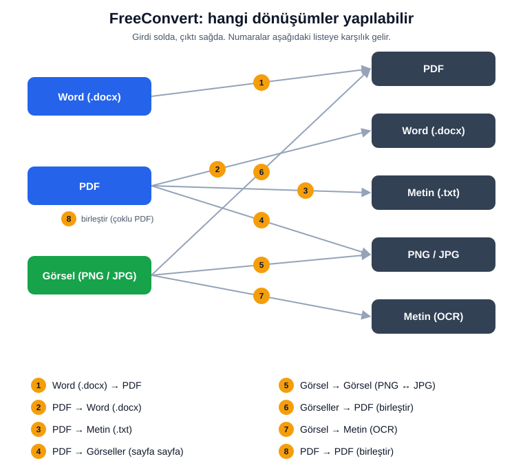

# FreeConvert

FreeConvert is a portable, offline Windows document converter with a Tkinter
user interface. It is designed to run as a single `.exe` without installing
Python, Microsoft Word, LibreOffice, OnlyOffice, Java, or a separate OCR
program.



## Download

[](https://github.com/erdemkoc1/FreeConvert/releases/download/v1.0.0/FreeConvert.exe)

[](https://github.com/erdemkoc1/FreeConvert/releases/download/v1.0.0/uninstall.exe)

No installation is required. Download `FreeConvert.exe` and run it. All
release versions are on the [Releases page](https://github.com/erdemkoc1/FreeConvert/releases).

## Features

- DOCX to PDF using python-docx + ReportLab
- PDF to editable DOCX using pdfminer/pdfplumber + python-docx
- Ruled and selected borderless PDF table reconstruction
- Native colspan/rowspan and multi-line table cells
- PDF merge, PDF-to-text, and PDF-to-image conversion
- Image format conversion and images-to-PDF
- Bundled local Turkish/English Tesseract OCR
- Turkish Unicode support through the bundled Noto Sans OFL font
- Turkish/English UI, light/dark themes, history, and portable settings

All document processing is local. The application does not send document data
to a cloud service.

## Runtime architecture

- PDF text/table parsing: `pdfplumber` + `pdfminer.six`
- PDF rendering/page access: `pypdfium2` / PDFium
- DOCX input/output: `python-docx`
- PDF generation: `reportlab`
- Images: `Pillow`
- OCR: bundled Apache-2.0 Tesseract runtime
- Unicode font: bundled Noto Sans under the SIL Open Font License

Microsoft Word, LibreOffice, OnlyOffice, PyMuPDF/MuPDF, Java, Ghostscript and
cloud conversion services are not called or bundled.

Legacy binary `.doc` input is not supported because no safe, complete
permissive pure-Python replacement is available. Use `.docx`.

## Build

Requirements:

- 64-bit Windows
- 64-bit Python 3.12
- PowerShell

```powershell
powershell -ExecutionPolicy Bypass -File .\build_portable.ps1
```

For a clean/reproducible build, use a fresh virtual environment and install the
pinned requirements first. The build script validates the bundled OCR runtime,
Noto fonts, license notices, final one-file output, and forbidden package
entries.

Output:

```text
dist\FreeConvert.exe
```

## Tests

```powershell
python -m unittest discover -s tests -v
python -m py_compile app.py converter\*.py
```

The frozen executable also supports a non-GUI diagnostic mode used to verify
portable builds without a source checkout:

```powershell
.\FreeConvert.exe --self-test pdf2word input.pdf output.docx result.json
.\FreeConvert.exe --self-test word2pdf input.docx output.pdf result.json
```

## License

Project source code is released under the MIT License. See `LICENSE`.

Third-party components and their licenses are documented in
`THIRD_PARTY_NOTICES.md`. Noto font terms are included at
`assets/fonts/OFL.txt`.
